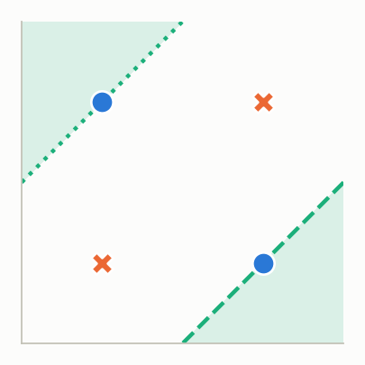
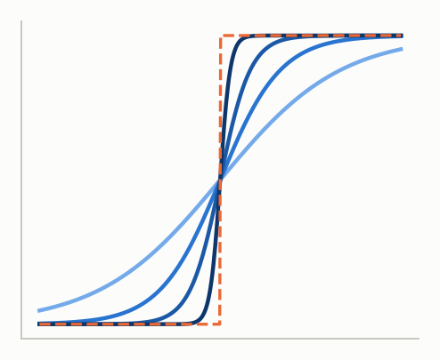
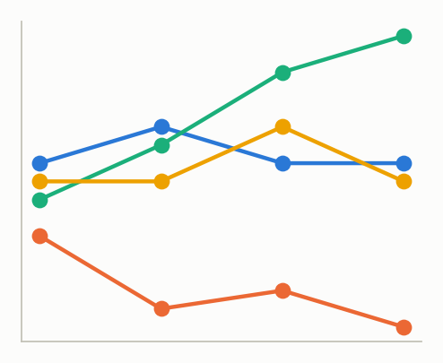
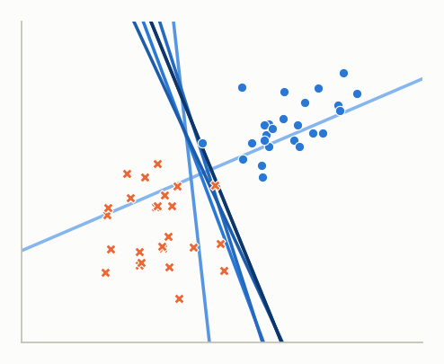
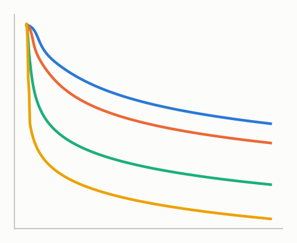
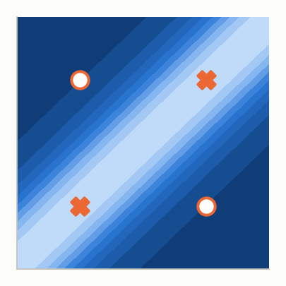
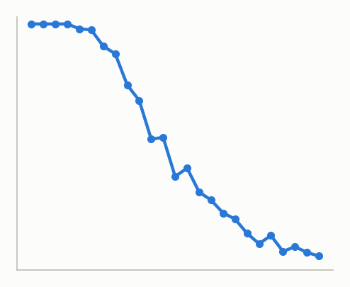
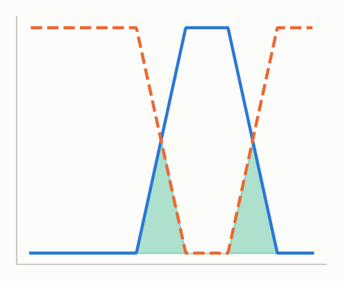
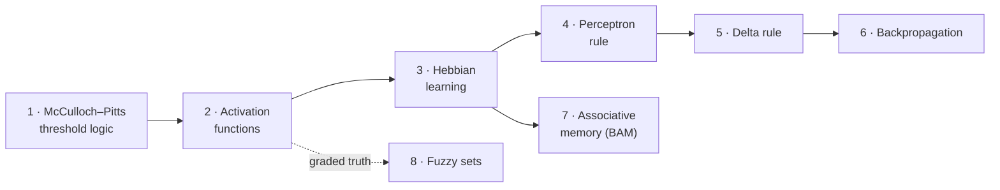

<div align="center">

# 🧠 Neural Network Lab

**Eight hands-on lessons that build classic neural networks from scratch — one equation, one line of NumPy at a time.**

[](https://github.com/anupbagale/Neural_Network_lab/actions/workflows/ci.yml)
[](https://colab.research.google.com/github/anupbagale/Neural_Network_lab/blob/main/notebooks/01_mcculloch_pitts_logic_gates.ipynb)
[](https://www.python.org/)
[](LICENSE)
[](LICENSE-CONTENT)


</div>

---

## Why this lab?

Modern deep-learning libraries hide the ideas that make neural networks work behind a single
`model.fit()`. This lab goes the other way. Starting from the 1943 McCulloch–Pitts neuron, each
lesson adds **one** new idea — a learning rule, an activation function, a hidden layer — derives it,
asks you to compute it **by hand**, then runs it in a few lines of readable NumPy and **shows** what
happened with a figure.

Every lesson follows the same rhythm:

> 🎯 **Objectives** → 💡 **Idea** → ✍️ **Work it by hand** → 🐍 **Code** → 📈 **See it** → 🧪 **Try it yourself** → ❓ **Check your understanding**

It is designed for an undergraduate course on neural networks or soft computing, and for anyone
learning on their own.

## 📚 Lessons

| | Lesson | You will learn to… | Time | |
|:-:|---|---|:-:|:-:|
|  | **1 · [McCulloch–Pitts Neurons & Logic Gates](notebooks/01_mcculloch_pitts_logic_gates.ipynb)** | build AND/OR/NOT/NAND/NOR by hand, see why XOR needs two layers | 25 min | [](https://colab.research.google.com/github/anupbagale/Neural_Network_lab/blob/main/notebooks/01_mcculloch_pitts_logic_gates.ipynb) |
|  | **2 · [Activation Functions](notebooks/02_activation_functions.ipynb)** | compare step, sigmoid and ReLU families; derive sigmoid derivatives; meet vanishing gradients | 25 min | [](https://colab.research.google.com/github/anupbagale/Neural_Network_lab/blob/main/notebooks/02_activation_functions.ipynb) |
|  | **3 · [Hebbian Learning](notebooks/03_hebbian_learning.ipynb)** | apply Δw = c·o·x; compare discrete and continuous neurons; watch weights explode | 25 min | [](https://colab.research.google.com/github/anupbagale/Neural_Network_lab/blob/main/notebooks/03_hebbian_learning.ipynb) |
|  | **4 · [The Perceptron Learning Rule](notebooks/04_perceptron_learning_rule.ipynb)** | learn from mistakes with Δw = c(d − o)x; watch a boundary move; see convergence fail on XOR | 30 min | [](https://colab.research.google.com/github/anupbagale/Neural_Network_lab/blob/main/notebooks/04_perceptron_learning_rule.ipynb) |
|  | **5 · [The Delta Rule & Gradient Descent](notebooks/05_delta_rule.ipynb)** | derive the delta rule from the chain rule; read learning curves; tune the learning rate | 30 min | [](https://colab.research.google.com/github/anupbagale/Neural_Network_lab/blob/main/notebooks/05_delta_rule.ipynb) |
|  | **6 · [Backpropagation: Solving XOR](notebooks/06_backpropagation_xor.ipynb)** | derive and gradient-check backprop; see the hidden layer make XOR separable | 40 min | [](https://colab.research.google.com/github/anupbagale/Neural_Network_lab/blob/main/notebooks/06_backpropagation_xor.ipynb) |
|  | **7 · [Bidirectional Associative Memory](notebooks/07_bidirectional_associative_memory.ipynb)** | store and recall pattern pairs; use the energy function; measure memory capacity | 35 min | [](https://colab.research.google.com/github/anupbagale/Neural_Network_lab/blob/main/notebooks/07_bidirectional_associative_memory.ipynb) |
|  | **8 · [Fuzzy Sets & Their Algebra](notebooks/08_fuzzy_sets.ipynb)** | compute fuzzy union, intersection and complement; find the two laws that break | 30 min | [](https://colab.research.google.com/github/anupbagale/Neural_Network_lab/blob/main/notebooks/08_fuzzy_sets.ipynb) |

### Learning path



Lessons 1 → 6 form the core path from a single neuron to a trained multi-layer network.
Lesson 7 builds on Hebbian learning, and Lesson 8 can be taken any time after Lesson 2.

## 🚀 Getting started

### Option 1 — in the browser (no installation)

Click any **Open in Colab** badge above. The first cell of each notebook installs the small `nnlab`
helper package automatically.

### Option 2 — on your own computer

```bash
git clone https://github.com/anupbagale/Neural_Network_lab.git
cd Neural_Network_lab
python -m pip install -e ".[dev]"     # installs nnlab, Jupyter and the test tools
jupyter lab notebooks/
```

The only runtime dependencies are **NumPy** and **Matplotlib** (see [`requirements.txt`](requirements.txt)).

## 🧩 The `nnlab` package

All algorithms live in a tiny package, [`nnlab/`](nnlab), written to be **read alongside the
equations** rather than for speed. You can also use it on its own:

```python
from nnlab.learning_rules import perceptron
from nnlab.backprop import TwoLayerNet

# Perceptron rule on the worked example from Lesson 4
hist = perceptron(w0=[1, -1, 0, 0.5],
                  X=[[1, -2, 0, -1], [0, 1.5, -0.5, -1], [-1, 1, 0.5, -1]],
                  d=[-1, -1, 1], c=0.1, epochs=100)
hist.print_steps()            # textbook-style table of every update

# A 2-2-1 network learns XOR with backpropagation
net = TwoLayerNet(V=[[1, -1, -1], [1, -2, 1]], W=[1, 1, -1], lr=0.05)
result = net.fit([[0, 0, 1], [0, 1, 1], [1, 0, 1], [1, 1, 1]], [0, 1, 1, 0])
print(result.epochs, net.predict([[1, 0, 1]]))
```

| Module | Contents |
|---|---|
| `nnlab.mcculloch_pitts` | `MPNeuron`, ready-made `GATES`, a two-layer `xor_network`, `truth_table` |
| `nnlab.activations` | step, sigmoid (with steepness λ), linear, ReLU and Leaky ReLU, plus derivatives |
| `nnlab.learning_rules` | `hebbian`, `perceptron`, `delta_rule` — each returns a full update `History` |
| `nnlab.backprop` | `TwoLayerNet` with explicit forward pass, backward pass and online training |
| `nnlab.bam` | `BAM` with outer-product storage, bidirectional recall and energy |
| `nnlab.fuzzy` | `FuzzySet` with `~`, `\|`, `&`, `-` operators and `check_properties` |
| `nnlab.style` | the colour-blind-checked palette and plot style used in every figure |

## 👩‍🏫 For instructors

- **Self-contained lessons.** Each notebook states its objectives, prerequisites and expected time,
  and ends with a summary and references, so lessons can be assigned individually.
- **By-hand first.** Every algorithm starts with a small worked example that students compute on
  paper before running code; the code then prints the same step-by-step table to check against.
- **Built-in formative assessment.** “Try it yourself” exercises and collapsible
  “Check your understanding” answers support both lab sessions and self-study.
- **Suggested use.** One or two lessons per lab session cover the whole lab in four to six
  sessions. Lessons 1–6 alone make a compact unit on single-neuron learning and backpropagation.
- **Verified content.** An automated test suite checks every algorithm against the hand-worked
  results, including a numerical gradient check of backpropagation, and CI re-runs every notebook
  on each change.

## 🗂️ Repository layout

```
Neural_Network_lab/
├── notebooks/          ← the eight lessons (start here)
├── nnlab/              ← readable implementations used by the lessons
├── tests/              ← pytest suite (algorithms reproduce the hand-worked results)
├── paper/              ← JOSE paper (paper.md, paper.bib)
├── docs/images/        ← README figures (regenerate with scripts/make_figures.py)
├── scripts/
└── .github/            ← CI workflows and issue templates
```

## ✅ Running the tests

```bash
python -m pytest                        # unit and regression tests
python -m pytest --nbmake notebooks/    # execute every lesson notebook
```

## 🤝 Contributing and support

Found a mistake, have an idea for an exercise, or used the lab in your class? Please
[open an issue](https://github.com/anupbagale/Neural_Network_lab/issues) — see
[CONTRIBUTING.md](CONTRIBUTING.md) for how to report problems, ask for help and propose changes.
Everyone taking part is expected to follow the [Code of Conduct](CODE_OF_CONDUCT.md).

## 📖 Citing

If you use this lab in teaching or research, please cite it using the metadata in
[`CITATION.cff`](CITATION.cff) (GitHub's **“Cite this repository”** button generates APA and
BibTeX for you).

## 📄 License

- **Code** (`nnlab/`, `tests/`, `scripts/` and the code cells of the notebooks) is released under the [MIT License](LICENSE).
- **Educational content** (lesson text, figures and the paper) is released under
  [Creative Commons Attribution 4.0 International](LICENSE-CONTENT).

## 🙏 Acknowledgements

The worked examples in Lessons 3–5 follow the classic examples in J. M. Zurada,
*Introduction to Artificial Neural Systems* (1992), whose notation the lab adopts throughout.
