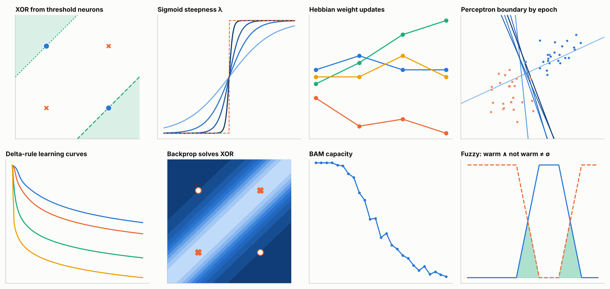

# Neural Network Lab

[](https://github.com/anupbagale/Neural_Network_lab/actions/workflows/ci.yml)
[](https://colab.research.google.com/github/anupbagale/Neural_Network_lab/blob/main/notebooks/01_mcculloch_pitts_logic_gates.ipynb)
[](LICENSE)
[](LICENSE-CONTENT)

Jupyter notebooks that implement the classic neural network algorithms from scratch in NumPy,
starting with a single McCulloch-Pitts neuron and ending with backpropagation, associative memory
and fuzzy sets.



Each notebook covers one algorithm. It explains the idea and the math, works through a small
example by hand, implements it in a few lines of NumPy and plots the result. The worked examples
follow the notation of J. M. Zurada, *Introduction to Artificial Neural Systems* (1992), so the
notebooks can be used next to that book or on their own.

## Lessons

| # | Notebook | Topics | Colab |
|---|---|---|---|
| 1 | [McCulloch-Pitts neurons and logic gates](notebooks/01_mcculloch_pitts_logic_gates.ipynb) | threshold neurons, AND/OR/NOT/NAND/NOR, why XOR needs two layers | [open](https://colab.research.google.com/github/anupbagale/Neural_Network_lab/blob/main/notebooks/01_mcculloch_pitts_logic_gates.ipynb) |
| 2 | [Activation functions](notebooks/02_activation_functions.ipynb) | step, sigmoid, ReLU, the steepness parameter, derivatives | [open](https://colab.research.google.com/github/anupbagale/Neural_Network_lab/blob/main/notebooks/02_activation_functions.ipynb) |
| 3 | [Hebbian learning](notebooks/03_hebbian_learning.ipynb) | unsupervised learning, discrete vs continuous neurons, weight growth | [open](https://colab.research.google.com/github/anupbagale/Neural_Network_lab/blob/main/notebooks/03_hebbian_learning.ipynb) |
| 4 | [Perceptron learning rule](notebooks/04_perceptron_learning_rule.ipynb) | error correction, bias, decision boundaries, convergence | [open](https://colab.research.google.com/github/anupbagale/Neural_Network_lab/blob/main/notebooks/04_perceptron_learning_rule.ipynb) |
| 5 | [Delta rule](notebooks/05_delta_rule.ipynb) | gradient descent, learning curves, learning rate | [open](https://colab.research.google.com/github/anupbagale/Neural_Network_lab/blob/main/notebooks/05_delta_rule.ipynb) |
| 6 | [Backpropagation](notebooks/06_backpropagation_xor.ipynb) | a 2-2-1 network that learns XOR, gradient checking, hidden representations | [open](https://colab.research.google.com/github/anupbagale/Neural_Network_lab/blob/main/notebooks/06_backpropagation_xor.ipynb) |
| 7 | [Bidirectional associative memory](notebooks/07_bidirectional_associative_memory.ipynb) | storing and recalling pattern pairs, energy, capacity | [open](https://colab.research.google.com/github/anupbagale/Neural_Network_lab/blob/main/notebooks/07_bidirectional_associative_memory.ipynb) |
| 8 | [Fuzzy sets](notebooks/08_fuzzy_sets.ipynb) | membership, union, intersection, complement, which set laws still hold | [open](https://colab.research.google.com/github/anupbagale/Neural_Network_lab/blob/main/notebooks/08_fuzzy_sets.ipynb) |

Lessons 1 to 6 are best done in order. Lesson 7 only needs lesson 3, and lesson 8 can be read
any time after lesson 2. Each one takes 25 to 40 minutes and ends with a few exercises.

## Running the notebooks

The easiest way is Google Colab: open any notebook with the link in the table. The first cell
installs everything it needs.

To run them locally you need Python 3.9 or newer:

```bash
git clone https://github.com/anupbagale/Neural_Network_lab.git
cd Neural_Network_lab
pip install -e ".[dev]"
jupyter lab notebooks/
```

## The nnlab package

The notebooks import their algorithms from `nnlab`, a small package in this repository. The code
is written to be easy to follow next to the equations rather than to be fast, and it can be used
outside the notebooks too:

```python
from nnlab.learning_rules import perceptron
from nnlab.backprop import TwoLayerNet

# perceptron rule on the example from lesson 4
hist = perceptron(w0=[1, -1, 0, 0.5],
                  X=[[1, -2, 0, -1], [0, 1.5, -0.5, -1], [-1, 1, 0.5, -1]],
                  d=[-1, -1, 1], c=0.1, epochs=100)
hist.print_steps()

# a 2-2-1 network trained on XOR
net = TwoLayerNet(V=[[1, -1, -1], [1, -2, 1]], W=[1, 1, -1], lr=0.05)
net.fit([[0, 0, 1], [0, 1, 1], [1, 0, 1], [1, 1, 1]], [0, 1, 1, 0])
```

| Module | What it contains |
|---|---|
| `mcculloch_pitts` | threshold neuron, logic gates, two-layer XOR network |
| `activations` | step, sigmoid, linear, ReLU, leaky ReLU and sigmoid derivatives |
| `learning_rules` | Hebbian, perceptron and delta rule training with a record of every update |
| `backprop` | network with one hidden layer trained by backpropagation |
| `bam` | bidirectional associative memory |
| `fuzzy` | fuzzy sets and their operations |
| `style` | plot settings shared by all figures |

## Tests

```bash
pytest                       # checks the algorithms against the hand-worked results
pytest --nbmake notebooks/   # runs every notebook from top to bottom
```

Both run automatically on GitHub for every push.

## Using this in a course

The notebooks were written to fit the classical part of a neural networks or soft computing
course, roughly one or two notebooks per lab session. Every notebook lists its objectives and
prerequisites at the top, so they can also be assigned individually. The exercises at the end have
hidden answers that can be expanded.

## Feedback

Found a mistake or something unclear? Please [open an issue](https://github.com/anupbagale/Neural_Network_lab/issues).

## Citation

If you use this material, please cite it using [CITATION.cff](CITATION.cff), or the
"Cite this repository" button on GitHub.

## License

The code is released under the [MIT License](LICENSE). The text and figures in the notebooks are
released under [CC BY 4.0](LICENSE-CONTENT).
